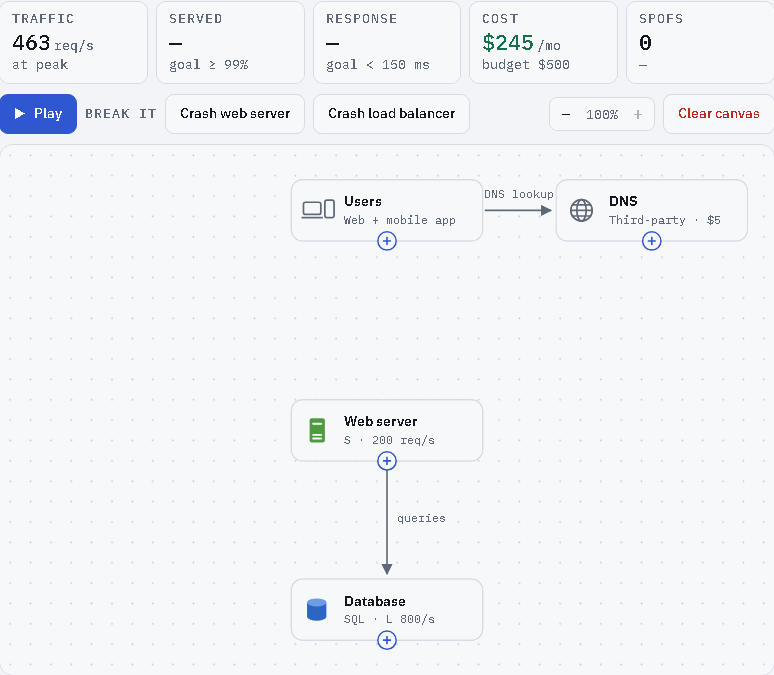
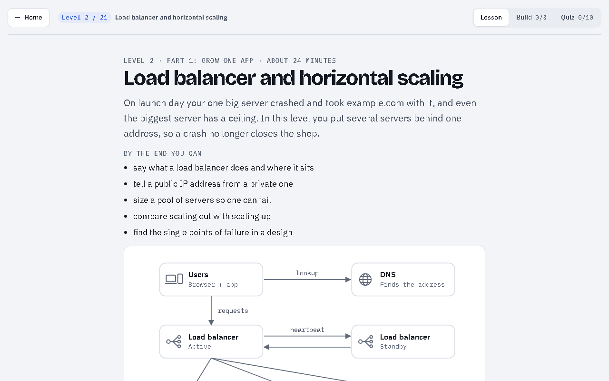
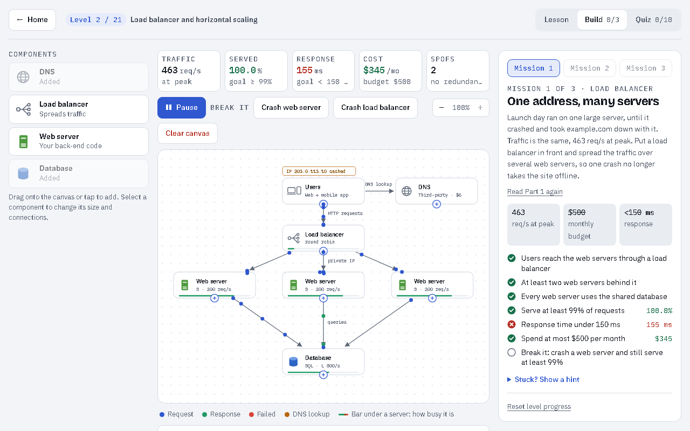
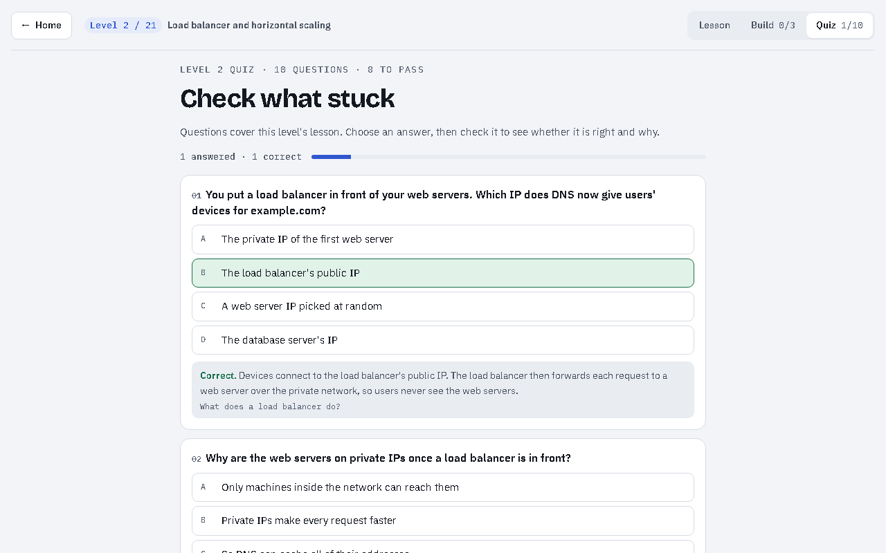

# System Design Levels

**Learn system design by building it.** Drag servers, load balancers, caches and databases onto a canvas, send
simulated traffic through them, then break things and watch what happens.

### [▶ Play it in your browser](https://tylereck81.github.io/System-Design-Levels/)

No sign-up and nothing to install. Your progress is saved in your browser.

<p align="center">
  
</p>

## Why I built it

System design interviews ask you to reason about things you can't see: how much traffic a server handles, what fails
when a cache restarts, why a design needs a second load balancer. Diagrams on paper don't push back. I wanted an
architecture that does: put in too few servers and requests fail, and leave a single point of failure and one click
takes the site down.

I built this while preparing for these interviews myself, so every level is something I needed to understand.

## How a level works

1. **Read a short lesson.** One idea at a time, with the numbers you need.
2. **Build it.** Each mission gives a traffic target, a response-time goal and a monthly budget. Meet all three.
3. **Break it.** Crash a server, restart a cache, cut off a data center. A good design keeps serving.
4. **Take the quiz.** Every answer explains why it's right or wrong.

| Lesson | Build and run | Quiz |
|---|---|---|
|  |  |  |

## What you learn

21 levels in three parts, then **mock interviews**: a timed problem on a blank canvas.

**Part 1: Grow one app.** One online shop, from a single server to several data centers.

1. One server to two tiers
2. Load balancer and horizontal scaling
3. Database replication
4. Cache tier
5. CDN for static content
6. Stateless web tier and autoscaling
7. Multiple data centers
8. Message queue, workers and monitoring
9. Scale the data tier with sharding

**Part 2: Building blocks.** The parts that large systems are made from.

10. Rate limiter
11. Consistent hashing
12. Distributed key-value store
13. Unique ID generator

**Part 3: Design real systems.** Classic interview questions, end to end.

14. URL shortener
15. Web crawler
16. Notification system
17. News feed
18. Chat system
19. Search autocomplete
20. Video platform
21. Cloud file sync

## How it's built

Plain HTML, CSS and JavaScript (ES modules), with no framework and no build step. The simulation is written from
scratch: each component has a capacity, a latency and a monthly cost, and the game works out load, queueing, failures
and the bill each frame. It runs entirely in the browser and is hosted on GitHub Pages.

The project is tested with Playwright and Node's test runner: unit tests for the simulation, a test for every level's
missions, end-to-end tests that play the game in a real browser, and accessibility checks with axe. All of them run on
every push.

## Run it locally

Requires [Node.js](https://nodejs.org) 24 or later.

```bash
npm install
npm start          # open http://localhost:4173
```

## Test it

```bash
npx playwright install chromium   # first time only
npm test
```

## Project layout

| Path | What it is |
|---|---|
| `index.html` | The app shell: header with the Home button and level name, tabs, build area |
| `js/boot.js` | Entry point: shows the home page, or loads the level named in the URL and starts the game |
| `js/home.js` | The home page: what the game is and the level list with your progress |
| `js/main.js` | Start-up, tab routing and re-rendering after a change |
| `js/state.js` | Game state and saved progress |
| `js/engine/` | The simulation: component catalog, load and latency model, failures; `kinds/` holds the logic of each kind of system |
| `js/view/` | The canvas: drawing, dragging and connecting, request dots, the animation loop |
| `js/ui/` | Dashboard, inspector, mission panel, controls, log, lesson, quiz, mock interview panel |
| `js/*.js` (others) | Small shared helpers: URL routes, browser storage, formatting, checks on saved data and lessons |
| `levels/index.js` | The list of playable levels |
| `levels/level-NN.js` | Everything specific to one level: lesson, components, rules, missions, quiz and text |
| `levels/shared/` | Parts every level reuses: components, goals, connection rules, quiz and lesson helpers |
| `levels/mock.js` | The mock interview: a real-system level as a timed problem on a blank canvas |
| `css/styles.css` | All styles: design tokens, light and dark themes, layout |
| `tests/` | `unit/` and `integration/` run in Node, `e2e/` and `snapshot/` in the browser (Playwright); all run on GitHub on every push |

## License

[MIT](LICENSE)

---

Made by [Tyler Eck](https://github.com/Tylereck81).
